# Самостійна робота 4 (№2)

# Linux та локальний PyPI

Debian ARM64 у Docker Desktop; sshd працює як ssh.service.

## 1. Системні журнали

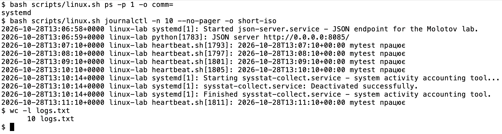

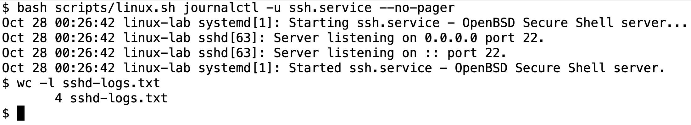

## 2. I/O та диски

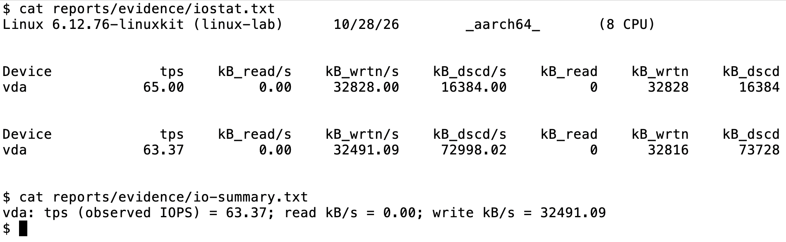

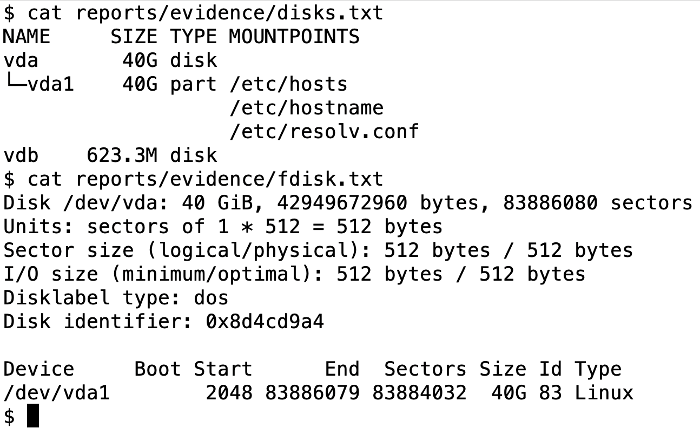

IOPS - операції/с; пропускна здатність - обсяг даних/с.

Виміряно активність віртуального диска Docker Desktop.

fdisk підтримує GPT/MBR; parted має resizepart та сценарний режим -s. resizepart не змінює файлову систему.

## 3. systemd-сервіс

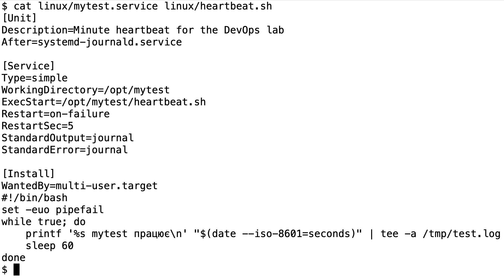

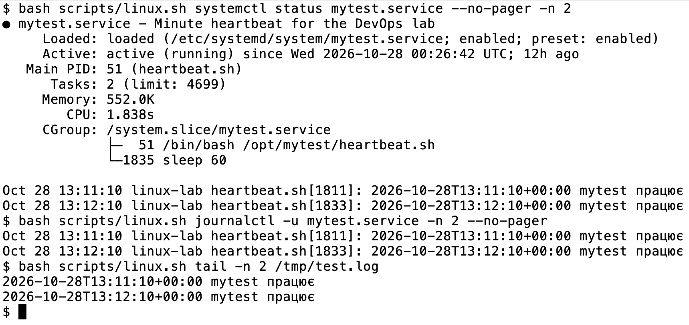

WorkingDirectory=/opt/mytest задає поточний каталог процесу. Абсолютний /tmp/test.log від нього не залежить.

## 4. Збірка пакета

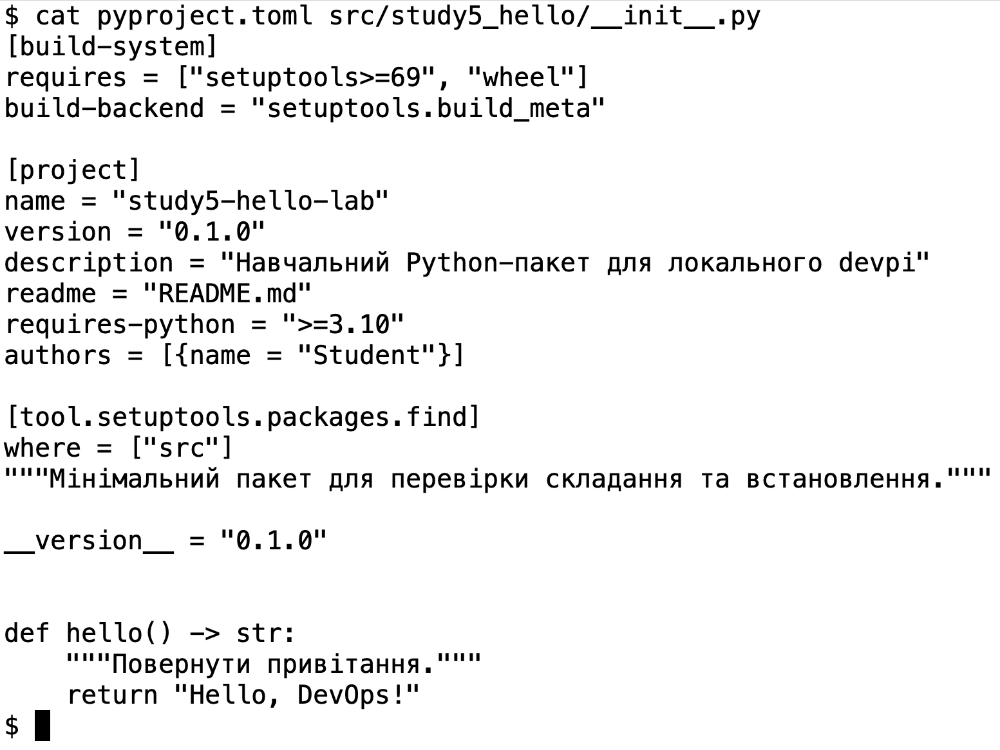

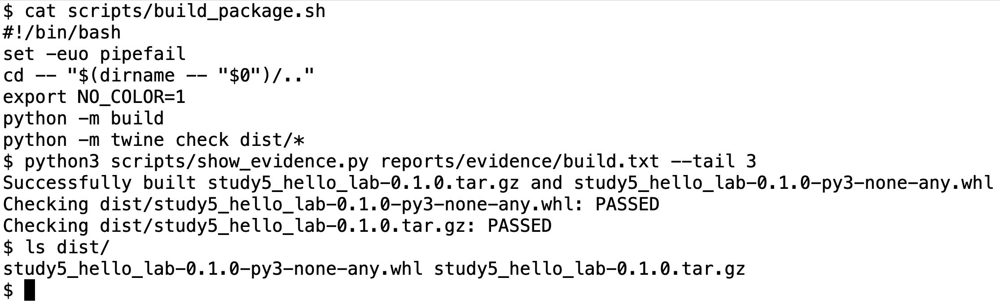

## 5. Локальний PyPI

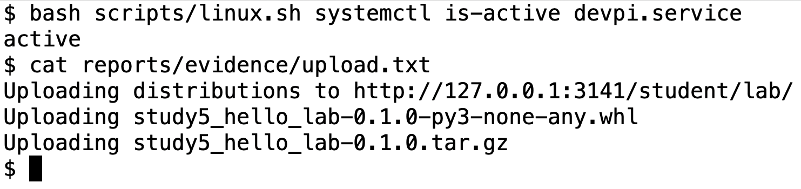

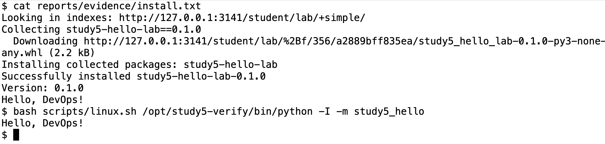

## 6. CHANGELOG та формати

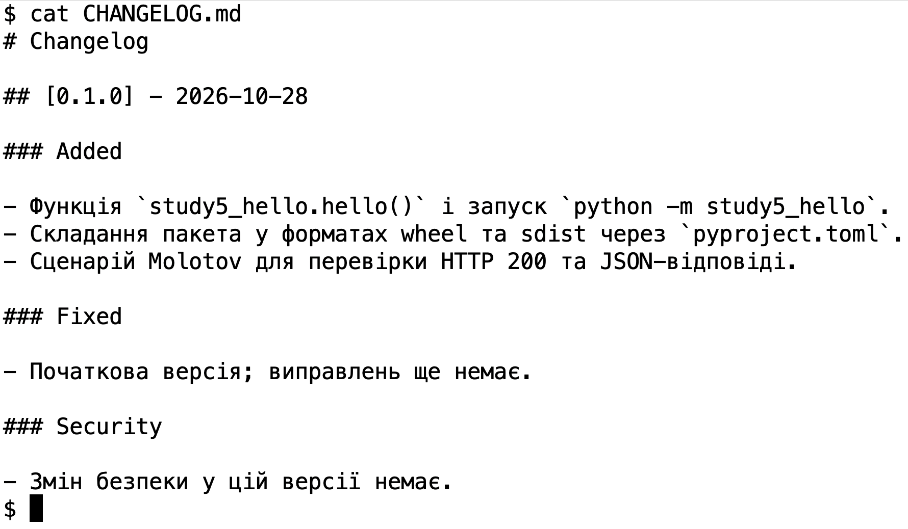

| Ознака | .deb | .rpm |
| --- | --- | --- |
| Інструменти | dpkg / APT | RPM / DNF |
| Структура | ar: control.tar, data.tar | Заголовки та cpio |
| Залежності | control: Depends | SPEC: Requires |

CHANGELOG пов'язує версію зі змінами та допомагає перевіряти релізи й відкат.

## 7. Molotov

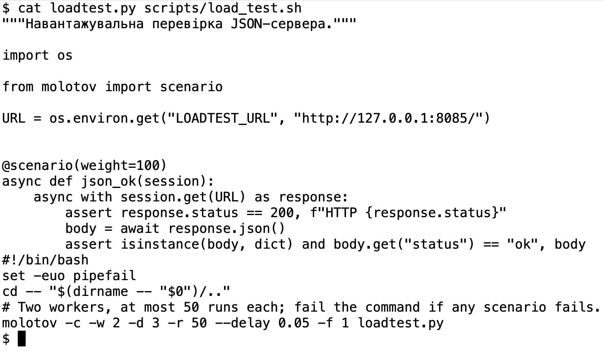

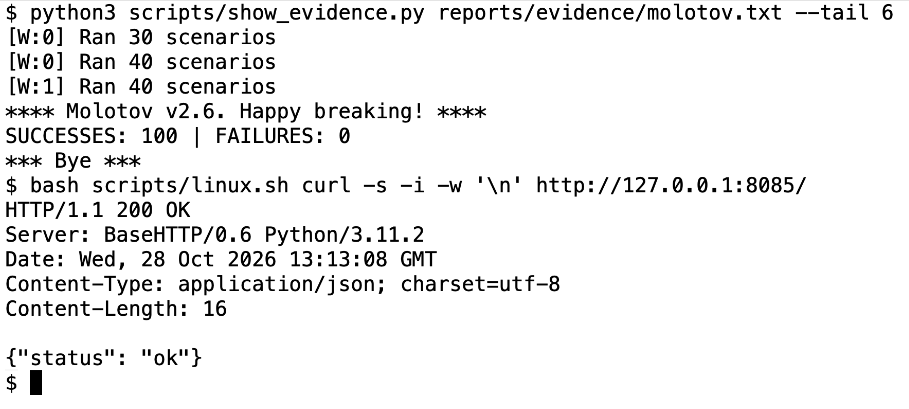

## 8. GitHub

https://github.com/mag871498-sys/independent-5-linux-pypi

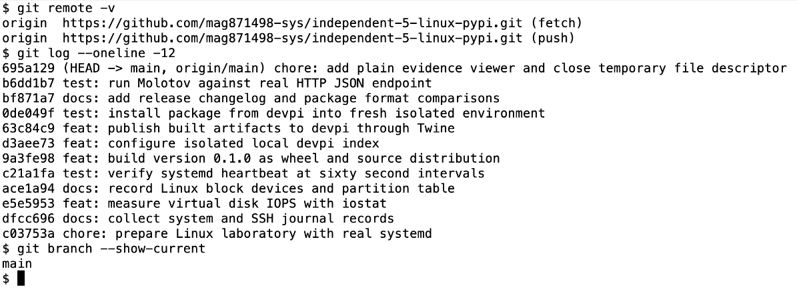
